# PSMNet on the Kria KV260

This repository runs stereo depth estimation with PSMNet (Vitis AI 3.0 model
zoo, `pt_psmnet_sceneflow_576_960_0.68_696G_3.0`) on a Kria KV260 with
PetaLinux 2022.2. The work is split between three engines:

| engine | runs |
|---|---|
| **DPU** (DPUCZDX8G, B512) | the 2D feature extraction and most of the 3D hourglass |
| **conv3d_fix PL kernel** (same xclbin as the DPU) | the 3D convolutions the DPU cannot run; a bit-exact CPU kernel is the fallback |
| **CPU** (Cortex-A53, NEON) | the feature upsampling, the cost volume, and the softmax with disparity regression (exp lookup table) |

## Repository layout

```
PSMNet/
├── README.md                            this file: overview and firmware build
├── PSMNet_Flow.md                       one frame through the whole app: stages, devices, data types, sizes, times
├── images/                              screenshots used in this README
├── model/                               download, trim and compile the PSMNet models for the B512 DPU
├── application/                         PsmNet class, demo_psmnet, demo_psmnet_live, sample images
├── kernel/cpu/                          conv3d-fix CPU kernel and op libraries (golden reference and fallback), tests
├── kernel/fpga/                         conv3d_fix HLS kernel, XRT host driver, FPGA op libraries, link config, C simulation
└── skills/
    ├── conv3d_kernel_skill/             skill: adding a custom PL kernel next to the DPU (from conv3d_fix)
    └── psmnet_application_skill/        skill: writing an application in the PsmNet style
```

## Documentation

| topic | document |
|---|---|
| Data flow of one frame: every stage, device, data type, tensor size and time | [PSMNet_Flow.md](PSMNet_Flow.md) |
| Firmware (DPU + conv3d_fix xclbin, bitstream, overlay) | [Building the firmware](#building-the-firmware) (below) |
| Models: download, trim, compile | [model/README.md](model/README.md) |
| Application: build, board setup, run, environment variables, troubleshooting | [application/README.md](application/README.md) |
| CPU conv3d kernel | [kernel/cpu/README.md](kernel/cpu/README.md) |
| FPGA conv3d kernel: HLS, C simulation, op libraries, verification, known issues | [kernel/fpga/README.md](kernel/fpga/README.md) |
| Skill: custom PL kernel next to the DPU | [skills/conv3d_kernel_skill/SKILL.md](skills/conv3d_kernel_skill/SKILL.md) |
| Skill: PsmNet-style application | [skills/psmnet_application_skill/SKILL.md](skills/psmnet_application_skill/SKILL.md) |

## Workflow

1. Build and test the conv3d kernels: [kernel/cpu/README.md](kernel/cpu/README.md) and
   [kernel/fpga/README.md](kernel/fpga/README.md) (C simulation, op libraries).
2. Build the firmware and install it on the board: [Building the firmware](#building-the-firmware).
3. Download, trim and compile the models: [model/README.md](model/README.md).
4. Build the application, copy it to the board and run it: [application/README.md](application/README.md).

## Building the firmware

This section creates the `dpu512_c` firmware app: an xclbin with one
DPUCZDX8G (B512) and one `conv3d_fix` kernel, its bitstream, the device-tree
overlay and `shell.json`. It uses the Vitis 2022.2 IDE.

### Prerequisites

Create the custom KV260 platform first. Follow the Xilinx tutorial
[KV260 platform creation](https://xilinx.github.io/Vitis-Tutorials/master/docs-jp/docs-jp/Vitis_Platform_Creation/Design_Tutorials/01-Edge-KV260/step1.html)
up to and including running the `vadd` example. Note the following:

1. Several code blocks in the tutorial are missing line breaks. Check each
   command before you run it.
2. In step 2, "Creating software components", sub-step 5 "Adding XRT to
   rootfs": add `zocl`, `opencl-clhpp` and `opencl-headers` as well as `xrt`.

Then download the Vitis AI 3.0 DPU TRD:
[`DPUCZDX8G_VAI_v3.0.tar.gz`](https://www.xilinx.com/bin/public/openDownload?filename=DPUCZDX8G_VAI_v3.0.tar.gz).

### Step 1: Create the Vitis project

In the directory where you unpacked the DPU TRD, rename the TRD folder to `DPU_TRD`
and create a workspace folder `dpu`:

```sh
mv DPUCZDX8G_VAI_v3.0 DPU_TRD
mkdir dpu
```

Start the Vitis IDE and select `dpu` as the workspace:

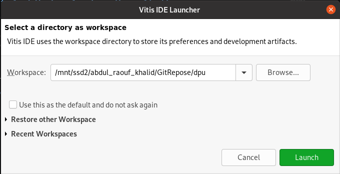

Open **Window → Preferences → Xilinx → Library Repositories**. Click
**Add** and set **Location** to the `DPU_TRD` folder, then click
**Apply and Close**:

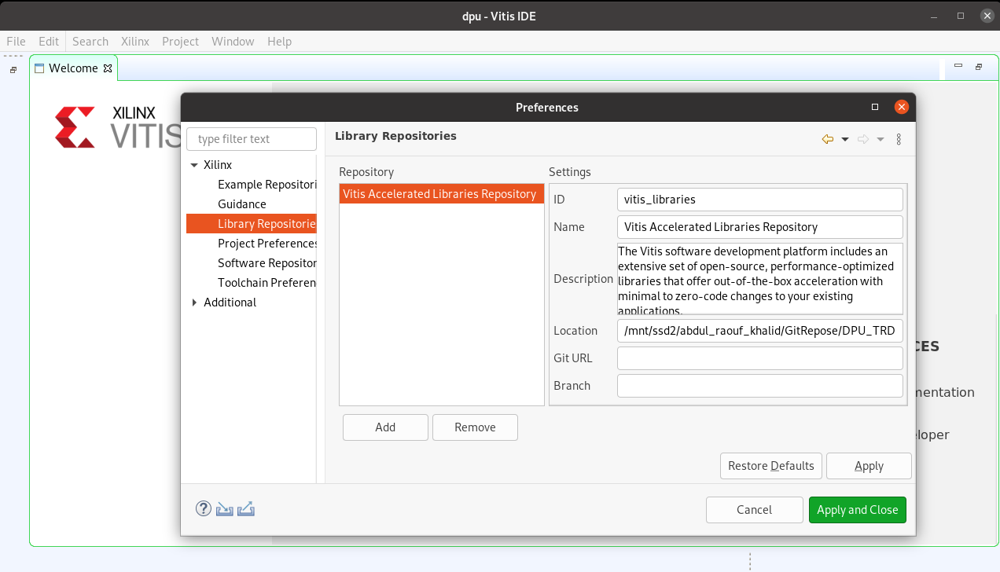

Click **Create Application Project**. Select the custom KV260 platform you
built for the `vadd` example (`kv260_custom`):

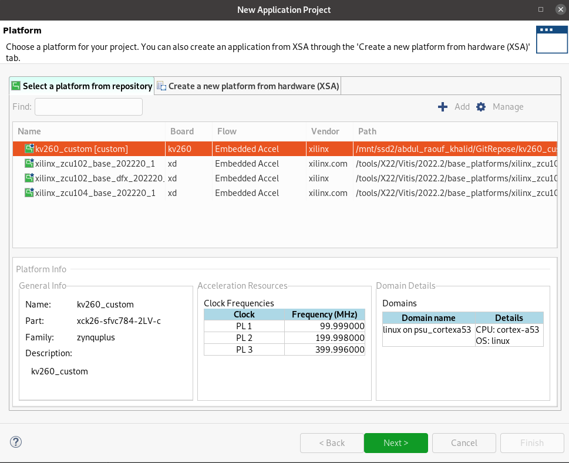

Set the application project name to `dpu`; the system project becomes
`dpu_system`:

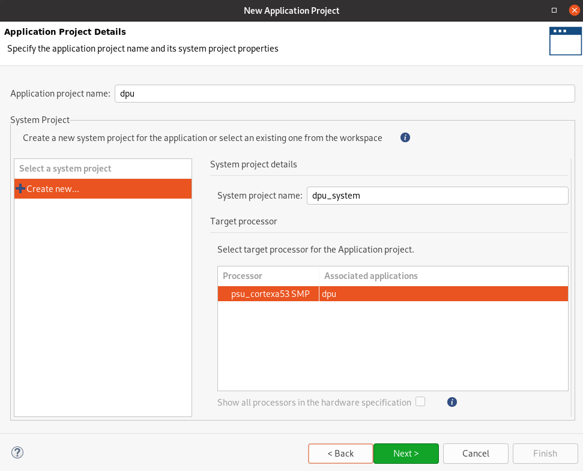

Set **Sysroot path**, **Root FS** and **Kernel Image** as in the `vadd`
example:

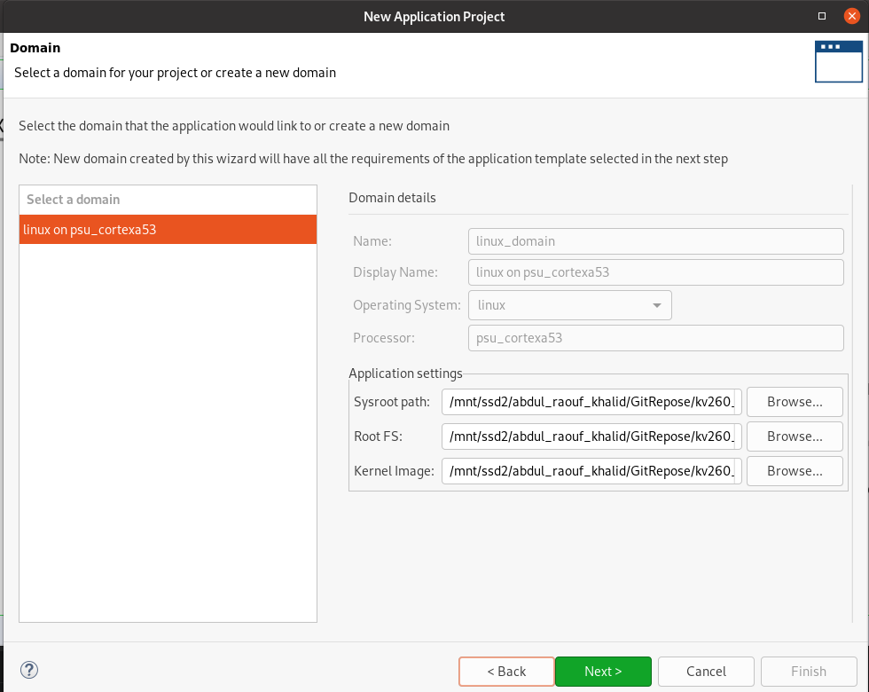

Select the **DPU Kernel (RTL Kernel)** template and click **Finish**:

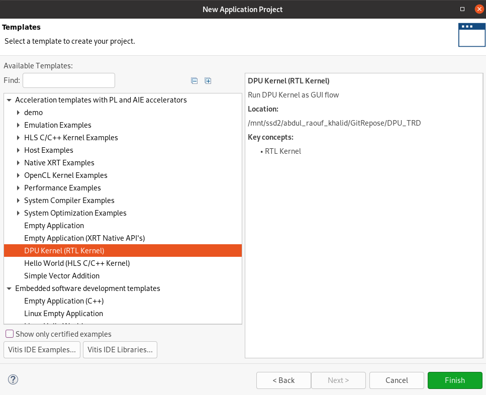

The project is created:

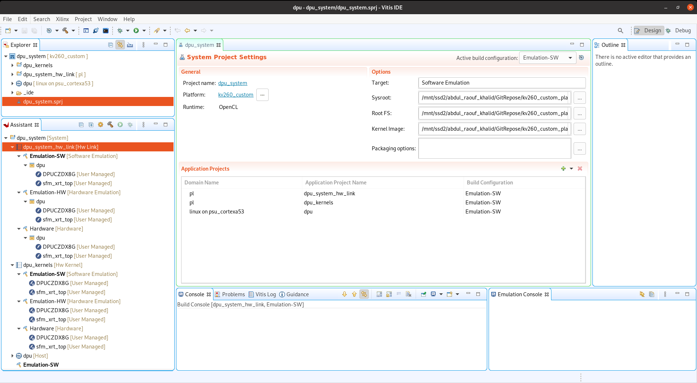

### Step 2: Add the conv3d_fix kernel

1. In **Explorer**, right-click `dpu_kernels` and select **Import Sources**.
   Set **From directory** to `PSMNet/kernel/fpga` and select
   `conv3d_fix_hls.cpp` and `conv3d_fix_hls.h`:

   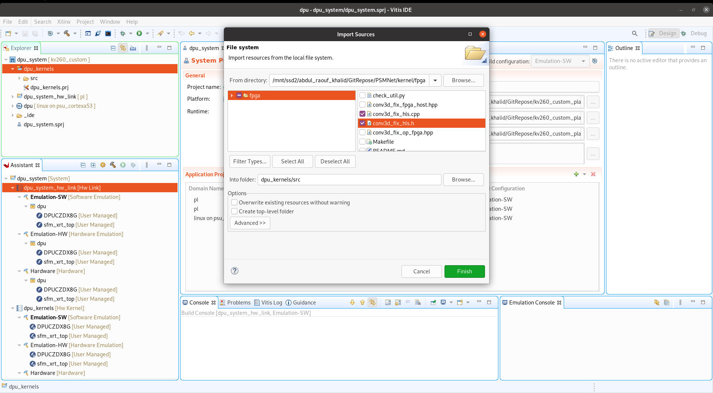

2. Set **Active build configuration** to **Hardware**:

   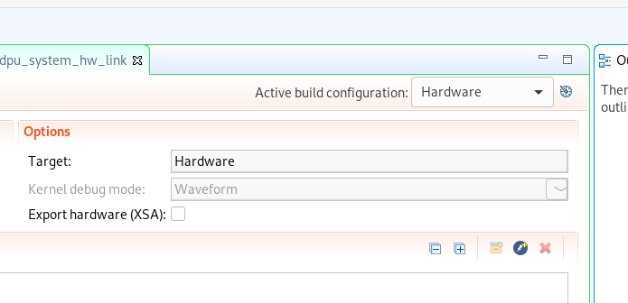

3. Open `dpu_kernels.prj`, click **Add Hardware Function** and select
   `conv3d_fix`:

   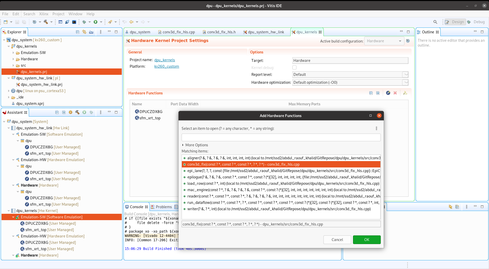

   The hardware functions should now be `DPUCZDX8G`, `conv3d_fix` and
   `sfm_xrt_top` (the softmax core is removed at the link step):

   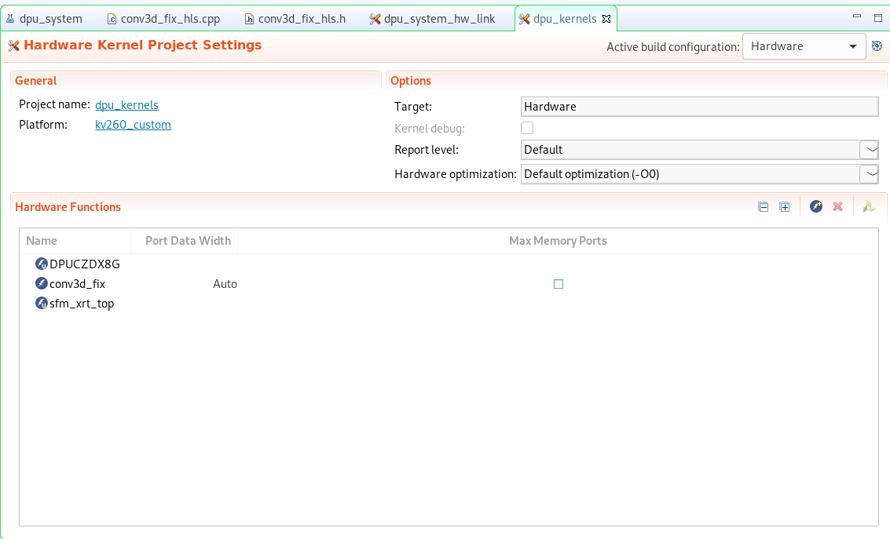

4. Select the B512 DPU: copy the contents of
   `DPU_TRD/prj/Vitis/dpu_settings/DPUCZDX8G_ISA1_B512.vh` into
   `dpu_kernels/src/prj/Vitis/dpu_conf.vh`. The application's models are
   compiled for B512, so the DPU size must match. The template default is B4096:

   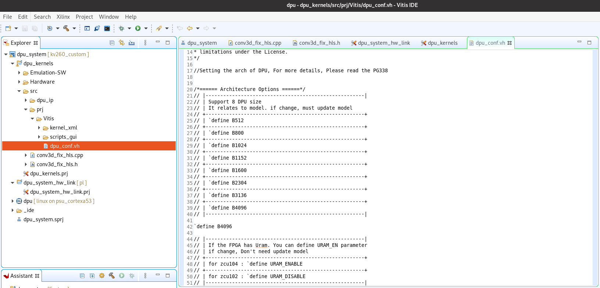

5. Right-click `dpu_kernels` and select **Build Project**.

### Step 3: Configure the link

1. Open `dpu_system_hw_link.prj`. In the binary container `dpu`, reduce
   `DPUCZDX8G` to one compute unit and remove `sfm_xrt_top`. The container
   should hold `DPUCZDX8G` (1) and `conv3d_fix` (1):

   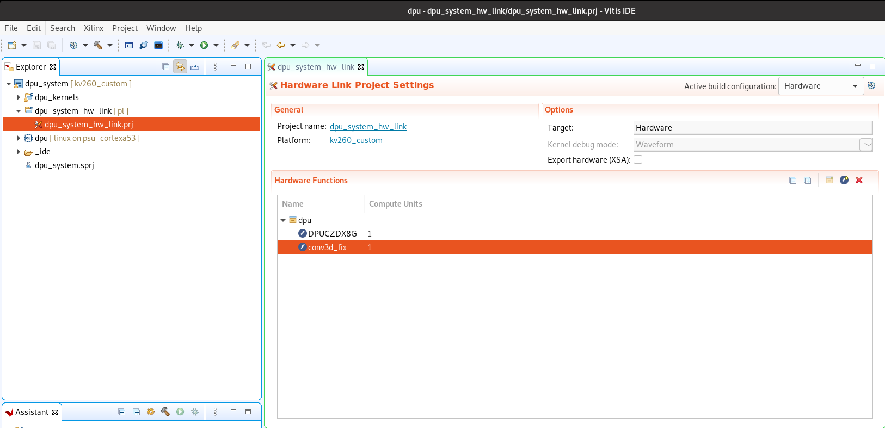

2. Save and close the Vitis IDE.

3. Open `dpu/dpu_system_hw_link/dpu_system_hw_link.prj` in a text editor. The
   file is XML, and every link-configuration line is a
   `<configSettings>...</configSettings>` element. In **each** configuration
   (`Emulation-SW`, `Emulation-HW` and `Hardware`), replace the template's
   `[clock]` and `[connectivity]` lines with the following lines. The template
   has a second DPU and 300/600 MHz clocks. Wrap every line in its own
   `<configSettings>` element and keep the XML valid.

   ```
   [clock]
   freqHz=200000000:DPUCZDX8G_1.aclk
   freqHz=400000000:DPUCZDX8G_1.ap_clk_2
   id=2:conv3d_fix_1.ap_clk

   [connectivity]
   sp=DPUCZDX8G_1.M_AXI_GP0:HPC0
   sp=DPUCZDX8G_1.M_AXI_HP0:HP0
   sp=DPUCZDX8G_1.M_AXI_HP2:HP1
   sp=conv3d_fix_1.input:HP0
   sp=conv3d_fix_1.output:HP1
   sp=conv3d_fix_1.weight:HP2
   sp=conv3d_fix_1.tab:HP2
   sp=conv3d_fix_1.cfg:HP2
   ```

   The conv3d_fix lines are also in
   [kernel/fpga/system.cfg](kernel/fpga/system.cfg). Platform clock ids are
   1 = 100 MHz, 2 = 200 MHz and 3 = 400 MHz; conv3d_fix must run on id 2.
   Why: [kernel/fpga/README.md, Known issues and fixes](kernel/fpga/README.md#known-issues-and-fixes).

### Step 4: Build

Open the workspace in the Vitis IDE again, right-click `dpu_system` and select
**Build Project**. The link takes 1–2 hours. It produces:

```
dpu/dpu_system_hw_link/Hardware/dpu.xclbin
dpu/dpu_system_hw_link/Hardware/dpu.build/link/int/system.bit
```

Check timing, utilization and the xclbin uuid as described in
[kernel/fpga/README.md, step 4](kernel/fpga/README.md#4-link-with-the-dpu--dpuxclbin).

### Step 5: Create the firmware files

1. Convert the bitstream. In `dpu/dpu_system_hw_link/Hardware/dpu.build/link/int`:

   ```sh
   echo 'all:{system.bit}' > bootgen.bif
   bootgen -w -arch zynqmp -process_bitstream bin -image bootgen.bif
   mv system.bit.bin dpu.bit.bin
   ```

2. Device-tree overlay: in the `pl.dtsi` generated for the `vadd` example, set

   ```
   firmware-name = "dpu.bit.bin";
   ```

   and compile it:

   ```sh
   dtc -@ -O dtb -o dpu512_c.dtbo pl.dtsi
   ```

3. Copy `shell.json` from the `vadd` example.

You now have the four firmware files: `dpu.xclbin`, `dpu.bit.bin`,
`dpu512_c.dtbo` and `shell.json`.

### Step 6: Install on the board

On the board, create `/lib/firmware/xilinx/dpu512_c/`, copy the four files
into it, and load the app:

```sh
sudo mkdir -p /lib/firmware/xilinx/dpu512_c
sudo cp dpu.xclbin dpu.bit.bin dpu512_c.dtbo shell.json /lib/firmware/xilinx/dpu512_c/
sudo xmutil listapps
sudo xmutil unloadapp
sudo xmutil loadapp dpu512_c
```

Check the DPU, and check that `/etc/vart.conf` contains
`firmware: /lib/firmware/xilinx/dpu512_c/dpu.xclbin`:

```sh
xdputil query
xdputil status
cat /etc/vart.conf
```

If the DPU does not work after these steps, see issues #6, #7 and #8
(`TODO: add the links`).

To replace only the xclbin and bitstream of an existing `dpu512_c` (for
example after a new link), and to install the conv3d op libraries, see
[kernel/fpga/README.md, step 7](kernel/fpga/README.md#7-copy-to-the-board).
Then continue with [application/README.md](application/README.md).
